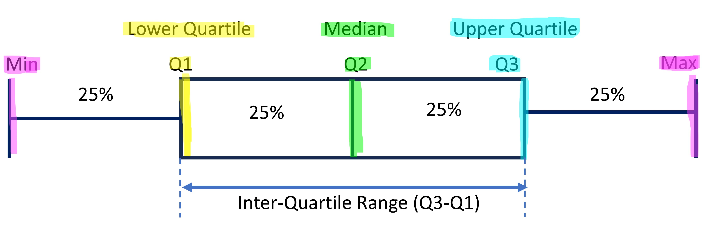

```{r}
#| label: setup-folders
#| include: false
# The regression chunks save results into a folder called "Results".
dir.create("Results", showWarnings = FALSE)
```

These notes follow the Computational Statistics class in R. They start with loading and cleaning data, then move to exploratory analysis and plots, and finish with regression.

## Loading datasets and library

```{r}
#install.packages("usdata")
library(usdata)
```

```{r}
# Load a dataset named as county data sets 
county
head(county)
```

::: {.callout-important appearance="simple"}
For a numeric variable we do not know the range (minimum and maximum) in advance, so we check it first.
:::

```{r}
my_data<- county
# Copy the data into a shorter name so it is easy to use.
```

```{r}
# attach() lets us use column names directly, without writing my_data$ every time.

attach(my_data)
```

```{r}
# Packages needed for these notes (install once, then load them).
#install.packages("ggplot2")
#install.packages("tidyr")
#install.packages("tidyverse")
#install.packages("dplyr")
#install.packages("rio")
#install.packages("labelled")
#install.packages("stargazer")
#install.packages("janitor")
```

```{r}
library(ggplot2)
library(tidyr)
library(dplyr)
library(rio)
library(tidyverse)
library(labelled)
library(stargazer)
library(janitor)
```

```{r}


# plot

my_data |> ggplot(aes(median_hh_income, unemployment_rate))
```

```{r}

my_data |> ggplot(aes(median_hh_income, unemployment_rate))+geom_point()
```

```{r}
# creating linear line using "lm"
my_data |> ggplot(aes(median_hh_income, unemployment_rate))+geom_point()+geom_smooth(method = "lm", se= F)
```

The scatter plot shows a negative association. The flatter the line, the weaker the association.

```{r}
boxplot(my_data$median_edu)
```

```{r}
# Step 1: keep only the variables we need.

my_data_1<- my_data|> select(median_hh_income, poverty, metro, median_edu)

# To drop variables instead, use select(-variable).

attach(my_data_1)
```

Rename the variables we want to change.

```{r}
my_data_1<- my_data_1 |> rename( median_inc = median_hh_income)

# Syntax: rename(new_name = old_name).
```

```{r}
# var_label() tells us what a variable is about.
var_label(my_data_1$median_inc)

# This variable has no label yet, so we assign one.


# Assign the label (a short description).

var_label(my_data_1$median_inc) <- "median household income"

# In a group project, every variable should carry a label like this.

```

```{r}
# Data cleaning part

# Clean the variables: outliers must be found and removed.
# We need the janitor package for this.

tabyl(metro) # frequency table of a categorical variable, to spot unusual categories

tabyl(my_data_1$median_edu) # frequency table of the education variable

# Outliers are always replaced with NA.

```

```{r}
# For a continuous variable, start with the summary.

summary(my_data_1$median_inc) 

# The summary shows the spread (range) of the data, but not clearly the outliers.


# Boxplots and histograms show the outliers.

boxplot(my_data_1$median_inc) 

# The same check with a histogram.

hist(my_data_1$median_inc) 

```

```{r}
# sum() counts how many observations satisfy a condition.

sum(my_data_1$median_inc>100000, na.rm = T) # how many values are above the cut-off
```

```{r}
# See what the plot looks like after trimming the outliers.

my_data_1 |> filter(my_data_1$median_inc>40000 & my_data_1$median_inc<100000) |> with(boxplot(median_inc))

```

```{r}

# The same with a histogram.
my_data_1 |> filter(my_data_1$median_inc>40000 & my_data_1$median_inc<100000) |> with(hist(median_inc))
```

```{r}
# Replace outliers by NA.

my_data_1 <- my_data_1 %>%
  mutate(median_inc = ifelse(median_inc < 20000, NA, median_inc))

# Check the result
summary(my_data_1$median_inc)

```

```{r}
# How to create a categorical variable from a continuous variable.
# First check the summary of the variable.

my_data_1 <- my_data_1 %>% mutate(poor = labelled(
  case_when(
    median_inc <= 45000 ~ 1,
    median_inc > 45000 ~ 0), # case_when() ends here; next we name the values (labels)
  c( Yes = 1, No = 2) # c() puts the labels together
))

# labelled() gives names to the values.
summary(my_data_1$poor)

# val_labels() shows the labels of the values (var_label() shows the label of the variable).
val_labels(my_data_1$poor)
```

```{r}
# Create poverty categories
my_data_1 <- my_data_1 %>%
  mutate(
    poverty = labelled(
      case_when(
        poverty >= 2 & poverty <= 11 ~ 1,
        poverty >= 12 & poverty <= 16 ~ 2,
        poverty >= 17 & poverty <= 52 ~ 3
      ),
      c(
        Poorest = 1,
        Poor = 2,
        Rich = 3
      )
    )
  )

# Check the variable
summary(my_data_1$poverty)

# Check value labels
val_labels(my_data_1$poverty)
```

#### Class of 08/09/2026

```{r}
# Convert factor to numeric 
my_data_1<- my_data_1 %>% mutate(metro = case_when(
  my_data_1$metro == "yes" ~ 1,
  my_data_1$metro == "no" ~ 0
))

tabyl(my_data_1$metro)
```

```{r}
# put label names back 
val_labels(my_data_1$metro)<- c(yes=1, no=0)
tabyl(my_data_1$metro)
```

```{r}
# Keep only the poverty range we want (and missing values).
summary(my_data_1$poverty)

my_data_1<- my_data_1|> filter(poverty>1 & poverty<3 | is.na(poverty))
```

# Exploratory Data Analysis (EDA)

With the data cleaned, we now describe it using summary statistics and plots.

1.  Summary Statistics

    ```{r}
    #install.packages("modelsummary")
    #install.packages("fastDummies")
    ```

```{r}
library(modelsummary) # for summary statistics 
library(fastDummies) # for making dummies automatically 
```

```{r}
# create dummies for categorical variable 

my_data_1<- dummy_cols(
  my_data_1,
  select_columns = "median_edu",
  remove_selected_columns = F
)
```

```{r}

#install.packages("pandoc")

library(pandoc)

# summary statistics 

datasummary(
metro
+median_edu_below_hs
+median_edu_hs_diploma
+median_edu_some_college
+median_edu_bachelors 
+median_edu_NA ~ 
  N+ Mean  +SD+ Min+ Max,
data = my_data_1,
output = "summary_statistics.docx"
)
```

```{r}
# Start again from the original county data.

df1<- county
```

```{r}
# Generate categorical variable with number as levels 

df1<- df1|> mutate(metro = case_when(df1$metro == "yes" ~ 1, df1$metro == "no" ~ 0))
```

```{r}
#  bar plot
ggplot(df1, aes(x= metro)) +geom_bar()
```

The plot is not good because R treats metro as a number. We must tell R that it is a categorical variable (a factor).

```{r}
#  bar plot
ggplot(df1, aes(x= factor(metro))) +geom_bar()
```

Make the plot more attractive by colouring the bars.

```{r}
ggplot(df1, aes(x= factor(metro), fill=factor(metro))) +geom_bar()
```

Now remove the missing values (NA) from the plot using filter().

```{r}
ggplot(df1|> filter(!is.na(metro)), aes(x= factor(metro), fill=factor(metro))) +geom_bar()
```

Next, clean up the axis labels.

```{r}
# edit axis labels and titles
ggplot(df1|> filter(!is.na(metro)),
       aes(x= factor(metro,
                     levels = c(0,1),
                     labels = c("no", "yes")),
           fill=factor(metro)))+
  geom_bar()
```

Now remove the legend, since the x-axis already shows the categories.

```{r}
ggplot(df1|> filter(!is.na(metro)),
       aes(x= factor(metro,
                     levels = c(0,1),
                     labels = c("no", "yes")),
           fill=factor(metro)))+
  geom_bar()+
  theme(legend.position = "none") # we can write "none" or ""
```

```{r}
ggplot(df1|> filter(!is.na(metro)),
       aes(x= factor(metro,
                     levels = c(0,1),
                     labels = c("No", "Yes")),
           fill=factor(metro)))+
  geom_bar()+
  labs(
    title = "Figure 1 : Bar Plot",
    x = "Metro Status",
    y = "Count",
    fill= "metro")+
  theme_minimal()+
  theme(legend.position = "none", 
        plot.title = element_text(hjust = 0.5))
```

Now the same plot with proportions instead of counts.

```{r}
df1|> filter(!is.na(metro))|>
  count(metro)|>
  mutate(prop= n/sum(n))|> # this will generate the proportion
  ggplot(
  aes(x= factor(metro,
                levels = c(0,1),
                labels = c("No", "Yes")),
      y = prop,
      fill=factor(metro)))+
  geom_col()+ 
  # we just have to change geom_bar() to geom_col() for proportion 
  labs(
    title = "Figure 1 : Bar Plot",
    x = "Metro Status",
    y = "Count",
    fill= "metro")+
  theme_minimal()+
  theme(legend.position = "none", 
        plot.title = element_text(hjust = 0.5))
```

#### Class of 15/09/2026

```{r}
#install.packages("scales")
library(scales)
```

Grouped bars: side by side across two categories.

```{r}
#| label: grouped-bar-plot
#| warning: false
#| message: false

library(dplyr)
library(ggplot2)

df1 <- county |> 
  mutate(metro = case_when(metro == "yes" ~ 1, metro == "no" ~ 0))

df1 |> 
  filter(!is.na(metro), !is.na(median_edu)) |>
  count(metro, median_edu) |> 
  group_by(metro) |>
  mutate(
    prop = n / sum(n), 
    top_lab = paste0(round(prop * 100, 1), "%")
  ) |>
  ggplot(aes(x = factor(metro, levels = c(0, 1), labels = c("No", "Yes")), 
             y = prop, 
             fill = factor(median_edu))) + 
  geom_col(position = "dodge") +
  geom_text(
    aes(label = top_lab),
    position = position_dodge(width = 0.9),
    vjust = -0.5,
    size = 3
  ) +
  labs(
    title = "Figure 1: Proportion of Median Education by Metro Status",
    x = "Metro Status",
    y = "Proportion",
    fill = "Median Education"
  ) +
  theme_minimal() +
  theme(
    plot.title = element_text(hjust = 0.5), legend.position = "right") +theme()
```

```{r}
library(dplyr)
library(ggplot2)
library(flextable)

df1 |> 
  filter(!is.na(metro), !is.na(median_edu)) |>
  count(metro, median_edu) |> 
  group_by(metro) |>
  mutate(
    prop = n / sum(n), 
    top_lab = paste0(round(prop * 100, 1), "%")
  ) |>
  ggplot(aes(x = factor(metro, levels = c(0, 1), 
                        labels = c("No", "Yes")), 
             y = prop, 
             fill = factor(median_edu))) + 
  geom_col(position = "stack") + 
  scale_y_continuous() +   # <--- Added the missing '+' here!
  geom_text(
    aes(label = top_lab),
    position = position_stack(vjust = 0.5), 
    size = 3,
    color = "white" 
  ) +
  labs(
    title = "Figure 1: Proportion of Median Education by Metro Status",
    x = "Metro Status",
    y = "Proportion",
    fill = "Median Education"
  ) +
  theme_minimal() +
  theme(
    plot.title = element_text(hjust = 0.5), 
    legend.position = "right"
  )
```

#### Contingency Tables

##### Cross tabulation of two or more categorical variables

::: callout-important
Use a contingency table only when your data and report have several categorical variables.
:::

```{r}
library(janitor)
library(flextable)
```

```{r}
ct_1<- df1|> filter(!is.na(metro), !is.na(median_edu))|>
  mutate(across(c(metro, median_edu), as.factor))|>
  tabyl(metro,median_edu) |>
  adorn_percentages("all") |>
  adorn_pct_formatting() |>
  adorn_ns()
```

```{r}
ct_2<- flextable(ct_1)
save_as_docx(ct_2, path = "contg_1.docx")
```

##### Pie Chart

```{r}
#| label: pie-chart-with-labels
#| warning: false
#| message: false

library(dplyr)
library(ggplot2)

df1 |> 
  filter(!is.na(median_edu)) |>
  count(median_edu) |>
  mutate(
    prop = n / sum(n),
    top_lab = paste0(round(prop * 100, 1), "%")
  ) |>
  ggplot(aes(x = "", y = prop, fill = factor(median_edu))) +
  geom_col(width = 1, color = "white") +
  coord_polar(theta = "y") + # Turns the stacked bar into a pie chart
  geom_text(
    aes(label = top_lab),
    position = position_stack(vjust = 0.5), # Centers text in each slice
    color = "white",                        # White text for contrast
    size = 3.5                              # Label text size
  ) +
  labs(
    title = "Figure: Median Education Distribution",
    fill = "Median Education",
    x = NULL,
    y = NULL
  ) +
  theme_void() + # Removes background grid and axis lines
  theme(
    plot.title = element_text(hjust = 0.5),
    legend.position = "right"
  )
```

#### Continuous Variable

- First check the distribution of the variable (from minimum to maximum).

```{r}

  library(ggplot2)
  library(dplyr)

  df1 |> 
    filter(!is.na(poverty)) |> 
    ggplot(aes(y = poverty)) + 
    geom_boxplot(fill = "orange", color = "black", alpha = 0.7) +
    labs(
      title = "Figure: Box Plot of Poverty Rate", 
      y = " population in poverty",
      x = NULL
    ) +
    theme_minimal() +
    theme(
      plot.title = element_text(hjust = 0.5),
      axis.text.x = element_blank(), # Removes unnecessary x-axis text tick
      axis.ticks.x = element_blank()
    )
```

- The IQR (inter-quartile range) holds the middle 50% of the data.

- We can check for outliers by plotting a box plot.

  

```{r}
#| label: poverty-boxplot-filtered
#| warning: false
#| message: false

library(ggplot2)
library(dplyr)

df1 |> 
  filter(!is.na(poverty), poverty < 30) |> 
  ggplot(aes(y = poverty)) + 
  geom_boxplot(fill = "orange", color = "black", alpha = 0.7) +
  labs(
    title = "Figure: Box Plot of Poverty Rate", 
    y = " population in poverty",
    x = NULL
  ) +
  theme_minimal() +
  theme(
    plot.title = element_text(hjust = 0.5),
    axis.text.x = element_blank(),
    axis.ticks.x = element_blank()
  )
```

- A frequency polygon plots raw frequency (counts) on the Y-axis, whereas a density plot plots probability density (proportions) where the total area under the curve equals 1.

#### Class of 21/09/2026

```{r}

data1 <- data.frame(
  x = c(1, 3, 5, 7),
  y = c(4, 2, 6, 4))

data1

```

```{r}
cor(data1$x, data1$y)
```

Store the correlation in an object `r`, then print it and use it in the plot title:

```{r}

r <- cor(data1$x, data1$y)

print(r)

plot(data1$x, data1$y,
     main = paste("Scatter Plot (r =", round(r, 3), ")"),
     xlab = "X",
     ylab = "Y",
     pch = 19,
     col = "blue")
```

```{r}
## Task: from the poverty variable, create a categorical variable.
## Category 1 (Poorest) = at or below the median; category 2 (Poor) = between the median and the 3rd quartile; category 3 (Rich) = above the 3rd quartile.

# Then draw a bar plot of median_edu against these 3 categories: x-axis = Poorest, Poor, Rich; y-axis = percentage.
```

```{r}

library(ggplot2)
library(tidyr)
library(tidyverse)
library(dplyr)
library(rio)
library(labelled)
library(stargazer)
library(janitor)


df1 <- df1 %>%
  mutate(
    poverty_cat = labelled(
      case_when(
        poverty <= median(poverty, na.rm = TRUE) ~ 1,
        poverty > median(poverty, na.rm = TRUE) &
        poverty <= quantile(poverty, 0.75, na.rm = TRUE) ~ 2,
        poverty > quantile(poverty, 0.75, na.rm = TRUE) ~ 3),
      
      c(Poorest = 1,Poor = 2,Rich = 3)))
```

```{r}
df1 |>
  filter(!is.na(poverty_cat), !is.na(median_edu)) |>
  count(poverty_cat, median_edu) |>
  group_by(poverty_cat) |>
  mutate(
    prop = n / sum(n),
    top_lab = paste0(round(prop * 100, 1), "%")) |>
  ggplot(
    aes(
      x = factor(
        poverty_cat,
        levels = c(1, 2, 3),
        labels = c("Poorest", "Poor", "Rich")),
      y = prop,
      fill = factor(median_edu))) +
  geom_col(position = "dodge") +
  geom_text(
    aes(
      label = top_lab),
    position = position_dodge(width = 0.9),
    vjust = -0.5,
    size = 3) +
  scale_y_continuous(
    labels = function(x) paste0(x * 100, "%")) +
  labs(
    title = "Percentage of Median Education by Poverty Category",
    x = "Poverty Category",
    y = "Percentage",
    fill = "Education Level") +
  theme_minimal() +
  theme(
    plot.title = element_text(hjust = 0.5),
    legend.position = "right")
```

### Class of 12/10/2026: Regression

Now we move from describing the data to modelling the relationship between variables.

```{r}
library(openintro)
library(tibble)
library(dplyr)
library(tidyr)
library(tidyverse)
library(ggplot2)
library(rio)
library(labelled)
library(stargazer)
library(janitor)
library(purrr)
library(rlang)
library(lobstr)
library(scales)
library(flextable)
library(ivo.table)
library(modelsummary)
library(fastDummies)
library(haven)
```

```{r}
df<- loans_full_schema

attach(loans_full_schema)
```

```{r}
# Dependent variable - left side and independent variable right side 
reg_1<- lm(loans_full_schema$loan_amount ~ loans_full_schema$annual_income, data = df)

reg_1
```

```{r}
stargazer(reg_1, type = "text")
```

- Export the results

```{r}
    stargazer(reg_1,
              omit.stat = c("f", "ser"),
              type = "text",
              out = "Results/reg_1.ref")
```

- We are checking the relationship between annual income and loan amount (we fit a line).

- Interpretation of the intercept: the predicted loan amount when income is 0 (when the independent variable is 0, what is the value of the dependent variable).

- The slope is positive: loan amount and annual income move in the same direction. If income increases by 1 unit, the loan amount increases by 0.052 units. 0.052 is the magnitude, and we must always mention the unit.

- Constant: at zero income, the predicted loan amount is 12,268.680 units.

- R²: income explains only 10.5% of the variation in the loan amount. The remaining ~90% of the variation is not explained by this model.

Plot the fitted line ( OLS line )

```{r}
ggplot(df, aes(
  x = annual_income,
  y = loan_amount ))+
  geom_point()+
  geom_smooth(
    method = "lm",
    intercept = coef(reg_1)[1], # coef from the regression the 1st coeff means intercept 
    slope =  coef(reg_1)[2], # 2nd means the slope
    color = "red",
    linewidth = 1)+
  theme_minimal()
  
```

```{r}
# now we can plot using abline
ggplot(df, aes(
  x = annual_income,
  y = loan_amount ))+
  geom_point()+
  geom_abline(
    intercept = coef(reg_1)[1], # coef from the regression the 1st coeff means intercept 
    slope =  coef(reg_1)[2], # 2nd means the slope
    color = "red",
    linewidth = 1)+
  theme_minimal()
  

```

**Now a regression with a categorical variable**

- we use factor() for categorical variable ( in case of regression )

```{r}
reg_2<- lm(loans_full_schema$loan_amount ~ factor(homeownership), data = df)

reg_2
```

```{r}
stargazer(reg_2, type = "text")
```

- Individuals who own their house have a loan amount that is 2,445.053 lower than the benchmark category, MORTGAGE (the omitted category).

- One category is left out, and every coefficient is compared with this reference category.

#### Class of 27/10/2026

```{r}
df$residuals <- residuals(reg_1)
# add the residuals to our data frame
```

```{r}
# now plotting the residuals 
ggplot(df,
       aes( x= df$annual_income, y = df$residuals))+
  geom_point() +
  geom_smooth(method = "lm",
              se = F)+
  labs(x = "Annual Income",
       y = "Residuals",
       title = "Residuals vs Annual Income")+
  theme_minimal()
```

- The expected value of the residuals given X is zero, so the line through the residuals is horizontal: positive and negative residuals cancel out. E(u|X) = 0.

- The average of the residuals is always 0.

**Now we are looking at categorical variable regression model**

```{r}
reg_2<- lm(df$annual_income ~ factor(df$homeownership), data = df)
# here homeownership is a categorical variable 
```

```{r}
stargazer(reg_2,
          omit.stat = c("f", "ser"),
          type = "text",
          out = "Results/reg_1.ref")
```

- If a variable has k categories, the regression reports (k-1) coefficients: one category is automatically omitted and serves as the benchmark.

- The constant is the mean of the dependent variable for the benchmark category (all dummies equal to 0).

- Those who own their home have a loan amount that is 2,445 lower than those with a mortgage.

```{r}
# create dummy 

df<- df|> filter(!is.na(df$homeownership)) |> mutate(
  home_dummy = case_when(homeownership == "MORTGAGE" ~ 1,
                         homeownership == "OWN" ~ 0,
                         homeownership == "RENT"~ 0
                         )
)
```

```{r}
reg_3 <- lm(df$loan_amount ~ factor(df$home_dummy), data = df)

```

```{r}
stargazer(reg_3,
          omit.stat = c("f", "ser"),
          type = "text",
          out = "Results/reg_1.ref")
```

> #### **Multiple Regression**

- We have two or more independent variables.

- The explanatory power increases, and so does R².

- Which independent variables should we include? Suppose we have 5 candidate variables, all related to the dependent variable. We cannot include everything, so we use the **stepwise method**.

- Stepwise selection has two versions: (i) backward and (ii) forward.

- Backward: start with all variables and remove one at a time (first v5, then v4, and so on), checking the model fit (we look at R²) after each step.

- Drop the variable whose removal gives the lowest fit, and keep the model where the fit is highest. This is the **backward elimination method**. **Forward** selection is the opposite: we start with no variables and add them one by one, and keep the model where R² is highest.

> ### Outliers in linear regression

- An outlier is a point or a group of points that stands out from the rest of the data.

- **Influential points:** outliers that change the slope of the line. These are the most harmful ones.

- If a point is in line with the bivariate model, it will not influence the least squares line (the slope stays the same).

- **Good practice:** report one model with the outlier and one without it.

#### Class of 02/11/2026

#### Multiple Regression Model

- Example: Grades ~ Hours, with coefficient 0.7 and R² = 0.32. There is only one independent variable (hours) explaining the dependent variable (grades).

- If we include more independent variables, the new model explains more variation, and its R² cannot be lower than that of model 1 (not less than 0.32).

- In multiple regression we do not rely only on R², because R² also rises when we add irrelevant variables. So we use a new measure: adjusted R².

- When we add an independent variable, R² never decreases, but adjusted R² may decrease.

- **Difference between R² and adjusted R²:**

- The core equations

  - **RSS (Residual Sum of Squares):** Measures the absolute error unexplained by the regression model. $$\text{RSS} = \sum_{i=1}^{n} (y_i - \hat{y}_i)^2 = \sum_{i=1}^{n} (y_i - \hat{\beta}_0 - \hat{\beta}_1 x_{1i} - \dots - \hat{\beta}_k x_{ki})^2$$

  - **TSS (Total Sum of Squares):** Measures the total variance present in the data relative to the sample mean. $$\text{TSS} = \sum_{i=1}^{n} (y_i - \bar{y})^2$$

    ### The Degrees of Freedom (why $n - k$ and $n - 1$)

  To convert raw sums of squares into true, unbiased variance metrics, we must scale them by their respective Degrees of Freedom (DoF):

  - **RSS is divided by** $(n - k )$
    - $n$ = Total sample size (number of data observations).
    - $k$ = Number of independent predictor variables ( $\hat{\beta}_0$ ,$\hat{\beta}_1, \hat{\beta}_2, \dots, \hat{\beta}_k$).
  - **TSS is divided by** $(n - 1)$
    - *Mathematical Rule:* When calculating the total baseline variance before adding predictors, you only estimate one single parameter from the data: the sample mean ($\bar{y}$). Losing that $1$ degree of freedom leaves you with exactly $(n - 1)$.

  Combining these components yields the complete mathematical expression for Adjusted $R^2$: $$\text{Adjusted } R^2 = 1 - \frac{\frac{\text{RSS}}{n - k }}{\frac{\text{TSS}}{n - 1}}$$

  - Standard errors

    - The standard deviation of the estimator.

    - If we repeat the sampling process many times, we get a distribution of $\hat{\beta}_k$, and its standard deviation is the standard error.

    - The standard error of $\hat{\beta}$ is linked to the residuals $\hat{u}$: it is calculated from the errors.

    - *(Notes to be completed.)*
